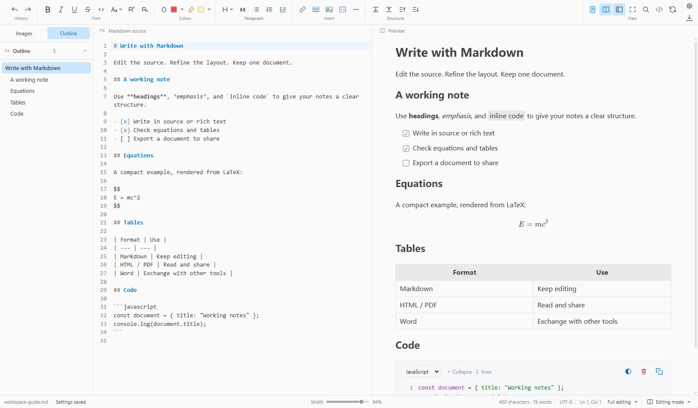

<p align="center"></p>

<h1 align="center">MDRE for VS Code</h1>

<p align="center"><strong>One Markdown document. Two ways to edit.</strong><br>Synchronized Markdown source and rich-text editing inside VS Code.<br><sub>VS Code 1.95+ · English / 简体中文</sub></p>

<p align="center">
  <a href="https://github.com/LaizhuangJi0601/MDRE-for-VS-Code/blob/main/CHANGELOG.md"></a>
  <a href="LICENSE"></a>
  <a href="https://code.visualstudio.com/"></a>
</p>

<p align="center"><a href="#features">Features</a> · <a href="#download-and-installation">Download and installation</a> · <a href="#development">Development</a> · <a href="#contributing">Contributing</a> · <a href="#license">License</a></p>

<p align="center"><strong>English</strong> · <a href="README.zh-CN.md">简体中文</a></p>

## Screenshot



## Features

- **Edit source and rich text together.** Keep both panes synchronized, or work in rich text alone. Format headings, lists, links, and text through the toolbar and context menus.
- **Write equations, diagrams, and code.** Render math with KaTeX, edit equations visually with MathLive, and use Mermaid diagrams, syntax highlighting, and code block themes.
- **Choose a reading layout.** Use continuous or paged A4 views with 25%–250% zoom. Outside A4, adjust reading width from 60% to 100% and choose one of four text alignments.
- **Work with tables and images.** Resize columns, align or merge cells, and split merged cells. Browse image references in document order and jump to their locations.
- **Export and exchange content.** Export HTML, PDF, or a ZIP containing Markdown and local images. Copy rich text and convert pasted HTML into Markdown.
- **Convert Word documents.** Import and export `.docx` through a separately installed Pandoc, including common document structures and equations.
- **Set up your workspace.** Choose light or dark themes, English or Simplified Chinese, view presets, categorized settings, and searchable offline help with chapter navigation.

Files, tabs, saving, and undo/redo use VS Code’s document model. MDRE is an optional Markdown editor, alongside VS Code’s built-in editor.

Editing and preview run locally. Editor resources, equation fonts, and help are bundled; remote images and external links depend on network access. See the [user guide](docs/help/en/usage.md) and [syntax reference](docs/help/en/syntax.md) for supported behavior.

## Download and installation

Current build: **0.2.6 · updata2**. See the [changelog](CHANGELOG.md) for version notes.

| Edition | Download | Requirements |
| --- | --- | --- |
| VS Code extension | [Download mdre-vscode-0.2.6.vsix](https://github.com/LaizhuangJi0601/MDRE-for-VS-Code/raw/refs/heads/main/mdre-vscode-0.2.6.vsix) · [SHA-256](SHA256SUMS.txt) | VS Code 1.95+ |

Download the VSIX and choose **Extensions: Install from VSIX…** in VS Code, or run:

```powershell
code --install-extension .\mdre-vscode-0.2.6.vsix --force
```

Reload VS Code, open a `.md` or `.markdown` file, and choose **Reopen Editor With → MDRE Split Editor**. You can also run **MDRE: Open split editor** from the Command Palette. The extension initially shows rich text; the split-view button reveals source.

PDF export requires a local Edge or Chrome installation. If detection fails, set `mdre.pdf.browserPath` in VS Code settings. The extension does not download Chromium.

Word conversion is optional. Install [Pandoc](https://pandoc.org/installing.html), then use Settings → Word conversion to detect it or select its executable. On Windows, specify the full path to **`pandoc.exe`**, not its folder. Complex Word layouts may simplify; review important converted documents.

Looking for the other edition? See the [Windows desktop app](https://github.com/LaizhuangJi0601/MDRE).

## Development

Use Node.js 24 LTS and pnpm 12.x, with VS Code for extension debugging.

```powershell
git clone https://github.com/LaizhuangJi0601/MDRE-for-VS-Code.git
cd MDRE-for-VS-Code
pnpm install --frozen-lockfile
pnpm build
pnpm package
```

`pnpm build` builds the extension host and webview; `pnpm package` creates the VSIX. Use `pnpm dev` for an Extension Development Host. See [development notes](docs/development.md) for checks and tooling.

## Contributing

Bug reports, suggestions, and pull requests are welcome. Use [Issues](https://github.com/LaizhuangJi0601/MDRE-for-VS-Code/issues) with the app version, reproduction steps, and a small Markdown example; include a screenshot for visual issues. Keep the English and Chinese documentation aligned when changing user-facing behavior.

## License

MDRE is released under the [MIT License](LICENSE). It builds on projects including [Tauri](https://tauri.app/), [CodeMirror](https://codemirror.net/), [ProseMirror](https://prosemirror.net/), [markdown-it](https://github.com/markdown-it/markdown-it), [KaTeX](https://katex.org/), [MathLive](https://mathlive.io/), [Mermaid](https://mermaid.js.org/), and [highlight.js](https://highlightjs.org/).

Third-party copyright and usage terms remain governed by their original licenses. See [notices and licenses](docs/help/en/notices.md).
