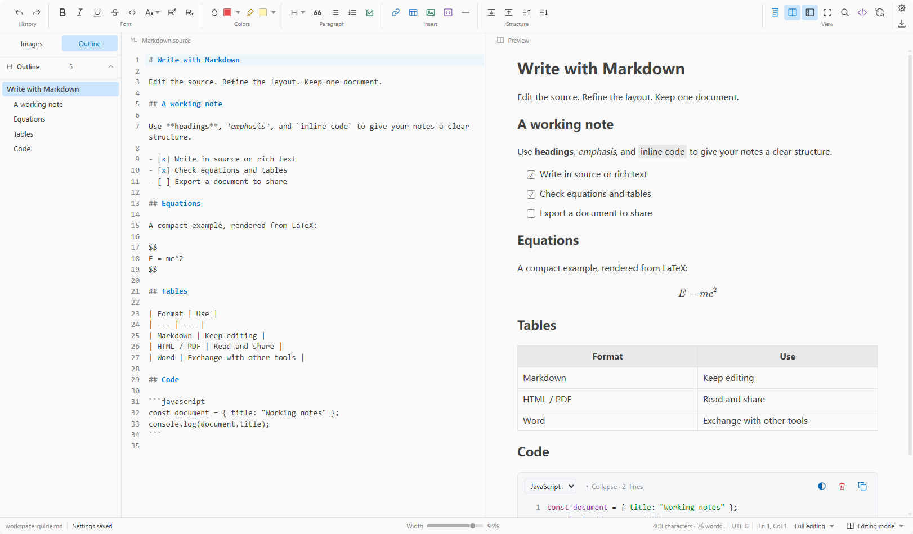

<p align="center"></p>

<h1 align="center">MDRE for VS Code</h1>

<p align="center"><strong>同一份 Markdown，两种编辑方式。</strong><br>在 VS Code 中同步编辑 Markdown 源码与富文本。<br><sub>VS Code 1.95+ · English / 简体中文</sub></p>

<p align="center">
  <a href="https://github.com/LaizhuangJi0601/MDRE-for-VS-Code/blob/main/CHANGELOG.md"></a>
  <a href="LICENSE"></a>
  <a href="https://code.visualstudio.com/"></a>
</p>

<p align="center"><a href="#功能">功能</a> · <a href="#开始使用">开始使用</a> · <a href="#文档">文档</a> · <a href="#开发">开发</a> · <a href="#许可">许可</a></p>

<p align="center"><a href="README.md">English</a> · <strong>简体中文</strong></p>

## 功能

- **源码与富文本同步编辑。** 两栏保持同步，也可仅显示富文本；标题、列表、链接与文字格式可通过工具栏或右键菜单编辑。
- **公式、图表与代码。** KaTeX 呈现数学公式，MathLive 提供可视化公式编辑；支持常见类型的 Mermaid 图表，以及代码高亮与代码块主题。
- **按阅读方式排版。** 支持 A4 连续或分页视图与缩放；非 A4 模式下可调整页宽并选择四种正文对齐方式。
- **处理表格与图片。** 调整列宽、对齐、合并与拆分单元格；按引用顺序浏览图片资源。
- **导出与互通。** 导出 HTML、PDF 或可分享 ZIP；支持复制为富文本与 HTML 转 Markdown 粘贴。
- **Word 转换。** 通过另行安装的 Pandoc 导入、导出 `.docx`。
- **查看 PDF 与 Word。** 用 MDRE 查看器打开 PDF（缩放与页面缩略图），并以只读方式阅读 Word 文档。
- **打开文本与代码文件。** 通过 MDRE 打开命令，将纯文本与常见代码文件交给 VS Code 原生编辑器高亮与编辑。
- **在编辑区上方查找。** 查找与替换显示在文档上方，不再占用侧栏；上一个／下一个匹配使用一致的箭头。
- **界面缩放。** 将菜单、对话框与状态栏在 80%–200% 之间缩放，正文不受影响。
- **按偏好组织工作区。** 设置以编辑器内弹窗打开并即时生效；提供浅色／深色主题、简体中文／English、视图预设、本机字体选择，以及可搜索的离线帮助与章节导航。

## 界面预览



## 开始使用

从扩展市场安装 MDRE，或安装 VSIX 后运行：

```powershell
code --install-extension .\mdre-vscode-0.3.0.vsix --force
```

重新加载 VS Code，打开 `.md` 或 `.markdown` 文件，选择 **重新打开编辑器方式 → MDRE 双栏编辑器**；也可在命令面板运行 **MDRE: 打开双栏编辑器**。同一命令可把 PDF 与 Word 文档交给 MDRE 查看器，把文本与代码文件交给 VS Code 编辑器。扩展默认显示富文本，工具栏的分栏按钮可显示 Markdown 源码。

保存、自动保存、撤销与重做使用 VS Code 原生文档机制；MDRE 是可选的 Markdown 编辑器，与内置编辑器并存。

PDF 导出使用本机 Edge 或 Chrome；检测失败时可在 VS Code 设置中填写 `mdre.pdf.browserPath`。Word 导入导出需要另行安装 [Pandoc](https://pandoc.org/installing.html)。

MDRE 在本机运行；编辑器资源、公式字体与离线帮助随扩展提供，网络图片与外部链接的可用性取决于网络。

## 文档

- [使用指南](docs/help/usage.md)
- [语法参考](docs/help/syntax.md)
- [声明与许可](docs/help/third-party-notices.md)
- [更新记录](CHANGELOG.md)

另一种使用方式：[Windows 桌面版](https://github.com/LaizhuangJi0601/MDRE)。

## 开发

需要 Node.js 24 LTS、pnpm 12.x，以及用于调试的 VS Code。

```powershell
git clone https://github.com/LaizhuangJi0601/MDRE-for-VS-Code.git
cd MDRE-for-VS-Code
pnpm install --frozen-lockfile
pnpm build
pnpm package
```

`pnpm dev` 可在 VS Code 扩展开发宿主中调试；开发检查见[开发文档](docs/development.md)。

## 参与贡献

欢迎通过 [Issues](https://github.com/LaizhuangJi0601/MDRE-for-VS-Code/issues) 报告问题或提出建议，也可提交 Pull Request。报告问题时请附版本、操作步骤和最小 Markdown 示例；界面问题可附截图。涉及文档的改动，请同步维护中英文说明。

## 许可

MDRE 采用 [MIT 许可证](LICENSE)。感谢 [Tauri](https://tauri.app/)、[CodeMirror](https://codemirror.net/)、[ProseMirror](https://prosemirror.net/)、[markdown-it](https://github.com/markdown-it/markdown-it)、[KaTeX](https://katex.org/)、[MathLive](https://mathlive.io/)、[Mermaid](https://mermaid.js.org/) 与 [highlight.js](https://highlightjs.org/) 等开源项目。

第三方组件的版权与使用条件以原始许可证为准，见[声明与许可](docs/help/third-party-notices.md)。
